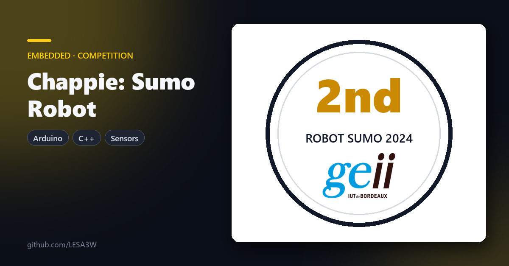

  

# Chappie, autonomous sumo robot

The Chappie program that enabled me to win **2nd place** in the regional Robot Sumo 2024 competition with the GEII department of the Bordeaux IUT.

**📣 The competition, as told by the GEII department:** [LinkedIn post](https://www.linkedin.com/posts/visite-des-%C3%A9tudiants-de-tsukuba-suite-et-ugcPost-7184459110245945344-IYI2/)

## What the program does

- **Finds the opponent** with 3 infrared distance sensors (front left, front right, side).
- **Stays on the ring** with 3 contrast sensors that detect the white edge.
- **Drives the two motors** through an H-bridge, direction and speed in PWM.
- **Starts the fight** on an infrared remote signal.

## Stack

Arduino · C++

The full program is in [`chappie_program_final.txt`](chappie_program_final.txt).
